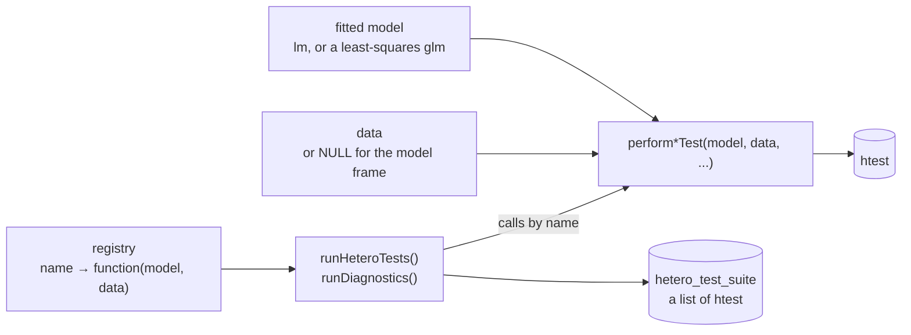

# Architecture

heteroTests is a set of test functions that share one calling convention and
one return type, a registry that names them, and runners that call them by
name.

## The calling convention

Every test takes `(model, data, ...)`, settled in 0.15.0 and set out at the top
of `R/interface.R`:

- `model` is a fitted `lm`, or a `glm` with the Gaussian family and the identity
  link, which gives the result of the `lm`.
- `data` is the data the model was fitted to. `data = NULL`, the default, stands
  for the model frame, which `rdata_or_model_frame()` rebuilds. Data that are
  given are matched to the residuals by row name, and a test refuses data whose
  rows it cannot confirm to hold the observations of the fit.
- Everything else, such as the variable to order by or the grouping factor,
  follows by name.

`performBoxMTest(data, group)` is the one exception: it tests the data, not
the residuals of a model. A call in a form that 0.15.0 replaced still works in
0.15.x, warns with the call to use instead, and stops working in 1.0.0.

Since 0.15.0 every test on a model refuses the same four inputs, each with one
message: a `glm` that is not a least-squares fit, a model with a coefficient
that is not finite, and data that lack rows or variables of the fit.

## The return contract

A test returns a base-R `htest` object with five fields, `statistic`,
`parameter`, `p.value`, `method` and `data.name`; some add the optional
`alternative` and `estimate`, and a few add fields of their own, such as the
bootstrap replicates. [What every test returns](reference/test_results.md)
documents every field, and `tests/testthat/test-return-contract.R` runs every
exported test against that page, so that a new test or a new field fails until
it is documented.

## The registry

The registry is an environment, `.diagnostic_registry`, filled in
`R/diagnosticsRegistry.R`. Each entry maps a name to a function of
`(model, data)` that calls a test with its defaults:

| Name | Test |
| --- | --- |
| `white`, `white_bootstrap` | `performWhiteTest()`, `performWhiteTestBootstrap()` |
| `breusch_pagan`, `koenker` | `performBPTest()`, `performKoenkerTest()` |
| `cook_weisberg` | `performCookWeisbergTest()` |
| `spread_level`, `szroeter` | `performSpreadLevelTest()`, and `performSzroeterTest()` ordered by the fitted values |
| `wild_bootstrap`, `rank_permutation`, `quantile_regression` | the resampling and quantile-regression tests |
| `high_dimensional`, `variance_form`, `spatial_hetero` | `performHighDimensionalTest()`, `performVarianceFormTest()`, `performSpatialHeteroTest()` with the weights in `attr(data, "listw")` |
| `box_m` | `performBoxMTest(data, group)`, for `runMultivariateTests()` |
| `ncv`, `student_bp` | deprecated in 0.14.0 for `cook_weisberg` and `koenker` |

[`listDiagnostics()`](reference/listDiagnostics.md) returns the names, and
[`registerDiagnostic()`](reference/registerDiagnostic.md) adds one. A second
registry, filled with [`registerPlot()`](reference/registerPlot.md), holds the
plots [`runDiagnosticPlots()`](reference/runDiagnosticPlots.md) draws.

## The runners

[`runHeteroTests()`](reference/runHeteroTests.md) is the runner the others
build on. For each call it:

1. prepares the model: an `lm` or `glm`, a formula fitted to `data`, a
   tidymodels workflow or a parsnip fit. Grouped data are split, and the model
   is refitted within each group from its own call;
2. checks the names in `tests` against the registry, and stops on one it does
   not know;
3. swaps in the streaming versions of the White, Breusch–Pagan and Koenker
   tests when the data are larger than `chunk_threshold_mb`;
4. runs each test, through the result cache when `use_cache = TRUE`. A test
   that fails is logged and a fallback that suits the error is tried; if none
   works the run stops with a message that says why, except with grouped data,
   where the failure is recorded in that group's result;
5. marks each result as a `hetero_test`, an `htest` with the attributes
   `diagnostic`, `nobs`, `model`, `data_source` and `extras`, and returns them
   as a `hetero_test_suite`, or a `hetero_grouped_suite` with one suite per
   group.

[`runDiagnostics()`](reference/runDiagnostics.md) adds the model checks to
those results: variance inflation factors, Ramsey's RESET and influence
measures. [`runHeteroTestsParallel()`](reference/runHeteroTestsParallel.md)
runs registered tests on a socket cluster, each test drawing from its own
L'Ecuyer-CMRG stream, so a seeded call gives the same value with any number of
workers. [`HeteroDiagnostic()`](reference/HeteroDiagnostic.md) keeps a model
and its data together, for `summary()` and `plot()`.

## Where things are

| Path | Holds |
| --- | --- |
| `R/` | One file per diagnostic, named after the function it defines, with no subdirectories. `R/interface.R` holds the calling convention and the checks of `data`; `R/validation.R` the input validation the tests share. |
| `man/` | The help pages. 52 of the 133 are written by hand and roxygen2 generates the rest; see [Development](development.md). |
| `tests/testthat/` | Unit tests, property-based tests and comparisons with reference implementations. |
| `inst/validation/` | Simulated size and power of the tests, and the scripts that produce them. |
| `inst/tutorials/` | A six-part course as Jupyter notebooks with an R kernel. |
| `vignettes/` | The long-form articles, also published as the [user guide](guide/using-heterotests.md). |
