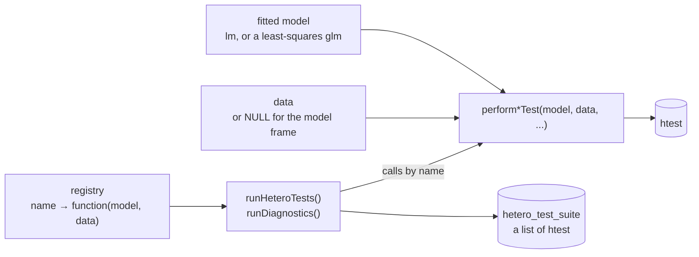

# Architecture

heteroTests is a set of test functions that share one calling convention and
one return type, a registry that names them, and runners that call them by
name.

## The calling convention

Every test takes `(model, data, ...)`, settled in 0.15.0 and set out at the top
of `R/interface.R`:

- `model` is a fitted `lm`, or a `glm` with the Gaussian family and the identity
  link, which gives the result of the `lm`.
- `data` is the data the model was fitted to. `data = NULL`, the default, stands
  for the model frame, which `rdata_or_model_frame()` rebuilds. Data that are
  given are matched to the residuals by row name, and a test refuses data whose
  rows it cannot confirm to hold the observations of the fit.
- Everything else, such as the variable to order by or the grouping factor,
  follows by name.

`performBoxMTest(data, group)` is the one exception: it tests the data, not
the residuals of a model. A call in a form that 0.15.0 replaced still works in
0.15.x, warns with the call to use instead, and stops working in 1.0.0.

Since 0.15.0 every test on a model refuses the same four inputs, each with one
message: a `glm` that is not a least-squares fit, a model with a coefficient
that is not finite, and data that lack rows or variables of the fit. Which
class of model each test accepts, and why, is the
[Supported models](models.md) page.

## The model context

Since 0.16.0 the tests are moving, in steps, onto an internal model context
(`R/model_context.R`): one validated object per call, built from the stored
fit, from which a test reads the response, the design, the residuals, the
weights, the offset and the rank, instead of rebuilding them from `data`. The
rows of `data` are matched to the observations of the fit by the guard of
0.15.0 before anything is read from them: named data in any order, numbered
data in fit order. White's, Breusch-Pagan, Koenker's, the rank permutation and
the high-dimensional tests are built on it, and so are the studentized
Breusch-Pagan statistic, RESET, Goldfeld-Quandt and the quantile regression
test, which carry the offset of the fit in their refits; the others still go
through `rdata_or_model_frame()`. [Design: the model context](design/model-context.md)
sets out the contract, the representation, the plan, the test matrix and the
decisions.

## The return contract

A test returns a base-R `htest` object with five fields, `statistic`,
`parameter`, `p.value`, `method` and `data.name`; some add the optional
`alternative` and `estimate`, and a few add fields of their own, such as the
bootstrap replicates. [What every test returns](reference/test_results.md)
documents every field, and `tests/testthat/test-return-contract.R` runs every
exported test against that page, so that a new test or a new field fails until
it is documented.

## The registry

The registry is an environment, `.diagnostic_registry`, filled in
`R/diagnosticsRegistry.R`. Each entry maps a name to a function of
`(model, data)` that calls a test with its defaults:

| Name | Test |
| --- | --- |
| `white`, `white_bootstrap` | `performWhiteTest()`, `performWhiteTestBootstrap()` |
| `breusch_pagan`, `koenker` | `performBPTest()`, `performKoenkerTest()` |
| `cook_weisberg` | `performCookWeisbergTest()` |
| `spread_level`, `szroeter` | `performSpreadLevelTest()`, and `performSzroeterTest()` ordered by the fitted values |
| `wild_bootstrap`, `rank_permutation`, `quantile_regression` | the resampling and quantile-regression tests |
| `high_dimensional`, `variance_form`, `spatial_hetero` | `performHighDimensionalTest()`, `performVarianceFormTest()`, `performSpatialHeteroTest()` with the weights in `attr(data, "listw")` |
| `box_m` | `performBoxMTest(data, group)`, for `runMultivariateTests()` |
| `ncv`, `student_bp` | deprecated in 0.14.0 for `cook_weisberg` and `koenker` |

[`listDiagnostics()`](reference/listDiagnostics.md) returns the names, and
[`registerDiagnostic()`](reference/registerDiagnostic.md) adds one. A second
registry, filled with [`registerPlot()`](reference/registerPlot.md), holds the
plots [`runDiagnosticPlots()`](reference/runDiagnosticPlots.md) draws.

## The runners

[`runHeteroTests()`](reference/runHeteroTests.md) is the runner the others
build on. For each call it:

1. prepares the model: an `lm` or `glm`, a formula fitted to `data`, a
   tidymodels workflow or a parsnip fit. Grouped data are split, and the model
   is refitted within each group from its own call;
2. checks the names in `tests` against the registry, and stops on one it does
   not know;
3. swaps in the streaming versions of the White, Breusch–Pagan and Koenker
   tests when the data are larger than `chunk_threshold_mb`;
4. runs each test, through the caches of results when `use_cache = TRUE`
   (below). A test that fails is logged and a fallback that suits the error is
   tried; if none works the run stops with a message that says why, except
   with grouped data, where the failure is recorded in that group's result;
5. marks each result as a `hetero_test`, an `htest` with the attributes
   `diagnostic`, `nobs`, `model`, `data_source` and `extras`, gives it the
   formula of the model as its `data.name`, and returns them as a
   `hetero_test_suite`, or a `hetero_grouped_suite` with one suite per group.
   Both print as a table of the tests, and their
   [`summary()`](reference/summary.hetero_test_suite.md) is laid out as that of
   an `lm`.

[`runDiagnostics()`](reference/runDiagnostics.md) adds the model checks to
those results: variance inflation factors, Ramsey's RESET and influence
measures. [`runHeteroTestsParallel()`](reference/runHeteroTestsParallel.md)
runs registered tests on a socket cluster, each test drawing from its own
L'Ecuyer-CMRG stream, so a seeded call gives the same value with any number of
workers. [`HeteroDiagnostic()`](reference/HeteroDiagnostic.md) keeps a model
and its data together, for `summary()` and `plot()`.

## The caches

Three caches keep results within a session, each in `R/cache.R`'s bounded
store: the results of single tests, read and written by
[`cachedTest()`](reference/cachedTest.md) and by each test of
`runHeteroTests(use_cache = TRUE)`; the results of whole calls of
`runHeteroTests()`; and the checks of `R/validation.R`. Their contract was
decided on 2026-10-21:

- **What is cached.** Only the tests the package registers and flags as
  deterministic (`R/diagnosticsRegistry.R`): `white`, `breusch_pagan`,
  `koenker`, `cook_weisberg`, `ncv`, `spread_level`, `student_bp`, `szroeter`,
  `quantile_regression`, `high_dimensional` and `variance_form`. A call of
  `runHeteroTests()` is stored as a whole only when all its tests are, and
  when no test fell back on one the caches may not hold (a diagnostic a user
  registered under the name of a fallback, or a resampling test). A call
  returns the same suite, `identical()`, with `use_cache = TRUE` and
  `FALSE`.
- **What is not.** A test that draws random numbers is never cached:
  `wild_bootstrap`, `white_bootstrap`, `rank_permutation` and `spatial_hetero`
  run on every call, through `cachedTest()`, `runHeteroTests()`, the registry
  and `runHeteroTestsParallel()` alike, so a seeded call returns what it
  returns without the cache and leaves the generator where it leaves it. Nor
  is `box_m`, which tests data, or a diagnostic added with
  `registerDiagnostic()` or `test_factory$register()`, or a name of the package
  registered again. A result whose computation moved `.Random.seed` is not
  stored either, and a check of `R/validation.R` that draws random numbers
  (the check of normality on more than `sample_limit` values) neither.
  `tests/testthat/test-cache-contract.R` runs every registered test and checks
  its flag against what it draws.
- **The key.** The test and its arguments; the class, family and link of the
  model; the parts of the model context the tests read, built without `data`
  (`rmodel_context()`): the model frame, the response, the design, the
  residuals and fitted values, the prior weights, the total offset, the rank
  and the aliased columns, the names of the observations and `na.action`; the
  coefficients, the weights the fit stores, the terms with their `predvars`,
  the call, the contrasts and levels, the residual degrees of freedom, whether
  the fit keeps its model frame, and its attributes; and `data`, whole. They
  are hashed with xxhash64 (**digest**), once per call of `runHeteroTests()`.
  The key holds values, not environments: the same model refitted in another
  environment hits, and the result returned carries the model of the call, so
  that it is `identical()` to the one the test computes. A model the context
  refuses has no key and runs uncached. The key leaves out the environment of
  the formula (a function or variable of it defined again after the fit) and
  the options of the session (`options(warn = 2)`, under which a call answered
  from the cache gives no warning to turn into an error); `?cachedTest` sets
  them out. The keys of the validation cache hold
  what each check reads, including the fitted values, weights, offset and
  family of the model, and the names a check is given as they are, NA and
  order included.
- **The bounds.** Each cache of results holds at most
  `getOption("heteroTests.cache_size", 100)` entries and the validation cache
  `getOption("heteroTests.validation_cache_size", 1000)`, each dropping the
  entry used least recently; `0` turns a cache off. An entry keeps no copy of
  the model. The keys are a character vector, never the names of an
  environment, which R would never free. `clearTestCache()`,
  `clearAnalysisCache()` and the internal `clearValidationCache()` empty them.

Building the key costs about 0.7 ms on a fit of 1,000 observations, 2.3 ms
on one of 10,000 and 20 ms on one of 100,000, against 2.6, 8.4 and 80 ms for
the Cook-Weisberg test, one of the cheapest; most of it is hashing the vectors,
which `rcache_hash()` serializes in the native byte order, into one raw vector
the size of the frame, the design and the data together. A hit costs the key
and little more.

## Where things are

| Path | Holds |
| --- | --- |
| `R/` | One file per diagnostic, named after the function it defines, with no subdirectories. `R/interface.R` holds the calling convention and the checks of `data`; `R/model_context.R` the model context; `R/validation.R` the input validation the tests share. |
| `man/` | The help pages. 52 of the 133 are written by hand and roxygen2 generates the rest; see [Development](development.md). |
| `tests/testthat/` | Unit tests, property-based tests and comparisons with reference implementations. |
| `inst/validation/` | Simulated size and power of the tests, and the scripts that produce them. |
| `inst/tutorials/` | A six-part course as Jupyter notebooks with an R kernel. |
| `vignettes/` | The long-form articles, also published as the [user guide](guide/using-heterotests.md). |
